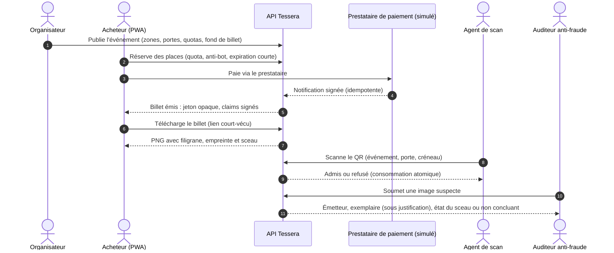
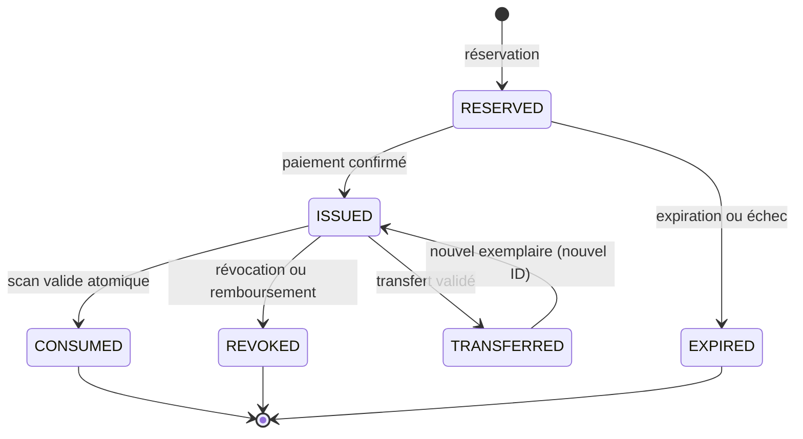

# Tessera

**Plateforme intelligente de billetterie numérique : anti-contrefaçon, anti-truquage et anti-scalping.**

> Projet de l'atelier *Sécurité applicative* — SUP'COM, INDP3 CySeD, 2026-2027 — Équipe 8 (binôme).
> Enseignant : Dr. Ing. Mohamed-Becha Kaâniche.

## Pitch

**Tessera** est une application web progressive (PWA/SPA) de **gestion de la billetterie de grands événements sportifs et culturels**. Elle couvre toute la vie d'un billet : publication de l'événement par l'organisateur, réservation et paiement par l'acheteur, émission d'un billet individualisé, téléchargement, transfert autorisé, contrôle à l'entrée par un agent, puis enquête anti-fraude si une image du billet circule hors de la plateforme.

Le nom renvoie à la *tessera* romaine, jeton servant de titre d'accès. Tessera en fait un titre numérique **vérifiable, attribuable et révocable** :

- l'**admission** n'est jamais décidée par l'image ni par le QR code seul, mais par le serveur, qui vérifie la signature, l'événement, le créneau, l'affectation et l'état du billet, puis consomme le billet de façon **atomique** (impossible d'entrer deux fois) ;
- le **visuel** du billet (PNG) porte trois mécanismes de **dissimulation de l'information** qui servent l'enquête, pas l'admission :

| Mécanisme | Technique | Question à laquelle il répond |
|---|---|---|
| **Filigrane** (watermarking) | marque robuste associée à l'organisateur | *Qui a émis ce visuel ?* |
| **Empreinte** (fingerprinting) | marque robuste individuelle, pseudonyme, par exemplaire téléchargé | *Quel exemplaire a fuité ?* |
| **Sceau stéganographique** | données d'accès chiffrées (AES-GCM) et signées (Ed25519), cachées dans les pixels, volontairement fragiles | *Ce fichier est-il l'original non modifié ?* |

## Le problème

Un billet numérique classique (QR statique, PDF, capture d'écran) se copie, se modifie, se revend et se présente plusieurs fois, sans qu'on sache d'où vient la fuite.

| Dimension | Faiblesse d'un billet classique | Réponse de Tessera |
|---|---|---|
| Authenticité | Un visuel ou un identifiant isolé peut être copié | Signature Ed25519 vérifiée côté serveur, identifiant opaque |
| Intégrité | Un siège ou une date modifiés passent inaperçus | Claims canoniques signés, sceau chiffré et authentifié |
| Attribution | Impossible d'identifier l'exemplaire divulgué | Empreinte individualisée et pseudonyme |
| Anti-rejeu | Une capture peut être présentée plusieurs fois | Consommation atomique, validation en ligne |
| Scalping | Achat automatisé et revente | Quotas, limitation de débit, réservations courtes, transfert officiel |
| Contrôle d'accès | Droits par type d'utilisateur seulement | RBAC complété par des attributs (événement, porte, créneau, terminal) |
| Audit | Journaux modifiables | Journal en insertion seule, corrélé, consultable par un rôle dédié |

## Flux utilisateur cible

1. **Publication.** L'organisateur crée l'événement, configure zones, portes, places, tarifs, quotas et règles de transfert, et téléverse un fond de billet.
2. **Réservation.** L'acheteur s'authentifie, choisit une place et obtient une réservation temporaire (quota, contrôle anti-bot, expiration courte).
3. **Paiement.** Redirection vers un prestataire de paiement (simulé) ; le serveur valide le paiement par une **notification signée serveur à serveur**, jamais par le seul retour du navigateur.
4. **Émission.** Le serveur crée un billet à identifiant opaque, produit les claims canoniques, les signe en Ed25519 et chiffre le contenu confidentiel.
5. **Personnalisation.** Filigrane, empreinte et sceau sont appliqués au visuel ; l'empreinte est enregistrée sous forme pseudonyme.
6. **Téléchargement.** L'acheteur récupère son billet depuis son portefeuille authentifié, par un lien court-vécu.
7. **Contrôle.** L'agent affecté scanne le QR ; le terminal transmet un jeton à l'API et ne décide jamais seul.
8. **Décision.** Le serveur vérifie signature, événement, créneau, porte, statut, affectation et absence de consommation antérieure, puis consomme le billet de façon atomique.
9. **Audit.** Tentatives répétées, transferts, refus et anomalies sont corrélés dans un journal à accès restreint.
10. **Enquête.** Si une image circule hors plateforme, l'auditeur anti-fraude la soumet à l'analyse : filigrane, empreinte et sceau sont extraits et vérifiés ; la correspondance empreinte–affectation n'est levée que sous justification enregistrée. Si les marques sont illisibles, le résultat est **« non concluant »** : aucune attribution douteuse.



### Cycle de vie d'un billet



Toute transition est contrôlée par le domaine métier côté serveur et journalisée ; un billet consommé, révoqué, expiré ou transféré ne revient jamais à `ISSUED`.

## Acteurs

| Rôle | Fait quoi | Limites (séparation des pouvoirs) |
|---|---|---|
| **Organisateur** | Crée et publie ses événements, définit les quotas, révoque selon procédure | Aucun accès aux événements d'un autre organisateur |
| **Acheteur** | Réserve, paie, télécharge, présente, transfère ses billets | Accès limité à son portefeuille |
| **Agent de scan** | Vérifie et consomme un billet à une porte et un créneau assignés | Ne peut pas rechercher un portefeuille |
| **Auditeur anti-fraude** | Consulte les alertes et journaux, analyse une image suspecte | Ne peut ni émettre ni révoquer ; accès sous justification |
| **Administrateur** | Gère comptes, rôles et configuration technique | Ne peut ni modifier un billet consommé ni effacer l'audit |

## Architecture et pile technique

| Couche | Technologies |
|---|---|
| Client | PWA/SPA (service worker limité au shell statique, aucune donnée de billet en cache) |
| Middleware | **Jakarta EE 11** sur **WildFly 42**, **Java 25** : Jakarta REST, CDI, Security, Persistence, Validation, Concurrency |
| Persistance | PostgreSQL ; journal d'audit séparé en insertion seule |
| Moteur d'information hiding | Module Java autonome (`javax.imageio`) : filigrane, empreinte, sceau LSB |
| Cryptographie | Ed25519 (signature), AES-256-GCM (sceau), HKDF, HMAC-SHA256, Argon2id (mots de passe) |
| Déploiement | Docker, GitHub Actions (SAST, SCA, tests d'autorisation, SBOM) |

> Le projet ne revendique pas de certification TCK Jakarta EE 11 sur Java 25 ; la compatibilité est vérifiée par des tests d'intégration sur la pile cible dès la semaine S1.

## Sécurité : démarche Shift-Left

La sécurité est spécifiée **avant** le code, avec **une seule approche** d'ingénierie des exigences de sécurité : les **cas d'abus** (*abuse cases*). Le recueil des besoins contient :

- **14 cas d'abus** écrits du point de vue de l'attaquant (scalping, rejeu, contrefaçon, BOLA, webhook forgé, image piégée, XSS, abus interne, fuite de secrets, déni de service…) ;
- **57 exigences de sécurité** (`SEC-xx`), mesurables et testables, classées selon les six types du cours (identification et authentification, autorisation, intégrité et confidentialité, non-répudiation, détection et audit, résilience et disponibilité) et **déclinées par couche de la pile** (Jakarta Security, Jakarta REST, Jakarta Persistence, Jakarta Concurrency, Undertow/Elytron, PWA, moteur d'images, CI/CD) ;
- la chaîne de traçabilité **cas d'abus → exigence → chapitre du cours → test**.

## Documents

| Document | Contenu |
|---|---|
| [`docs/cahier_des_charges.pdf`](docs/cahier_des_charges.pdf) | Cahier des charges fonctionnel, technique et organisationnel |
| [`docs/recueil_des_besoins.pdf`](docs/recueil_des_besoins.pdf) | Besoins fonctionnels, justification de l'approche SRE, cas d'abus, exigences de sécurité, traçabilité |

## Organisation du dépôt

```
docs/          cahier des charges et recueil des besoins (PDF, sources LaTeX)
backend/       API Jakarta EE 11 (WildFly 42, Java 25)
frontend/      PWA/SPA et application de scan
hiding-engine/ moteur de marquage d'images (filigrane, empreinte, sceau)
infra/         déploiement (Docker), durcissement
tests/         tests d'intégration, d'autorisation, d'abus, de charge
```

## Avancement

| Semaine | Contenu | État |
|---|---|---|
| S0 | Cadrage : cahier des charges, recueil des besoins | Livré |
| S1 | Socle Jakarta EE sur WildFly 42, identité et accès, intégration continue | À faire |
| S2 | Billetterie, signature, chiffrement, moteur de marquage | À faire |
| S3 | Scan, consommation atomique, analyse d'image, audit | À faire |
| S4 | Tests de sécurité, déploiement, documentation, démonstration | À faire |

## Limites assumées

Robustesse du filigrane et de l'empreinte limitée aux transformations modérées (sinon résultat « non concluant »), résistance à la collusion non garantie, contrôle hors ligne non supporté, paiement simulé, pas de place de marché secondaire ni d'application mobile native. Le détail figure au cahier des charges (§3.1) et au recueil des besoins (section 7).

## Équipe

Mohamed Fourat Boujdaria, Brahim Cheikh — Équipe 8, INDP3 CySeD, SUP'COM.
